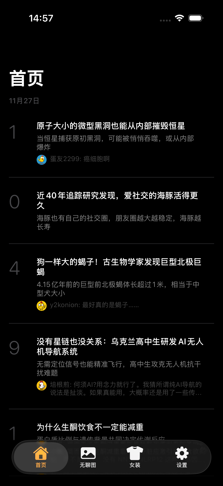
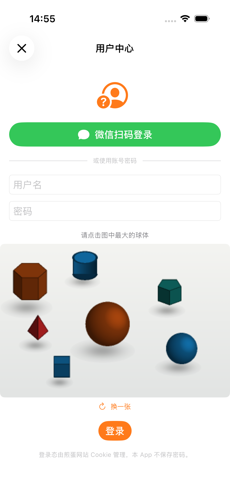

# 煎蛋 · JandanReader

用 **SwiftUI 原生 + jandan.net REST API** 做的 iOS 阅读客户端。内容全部走站点的公开接口，App 内自行排版；只有微信扫码登录页用 `WKWebView` 承载网页授权流程。

> **非官方客户端**，与煎蛋网无任何关联。内容版权归原站及原作者所有，本项目不提供任何内容服务，**仅供个人学习与自用侧载**，不计划上架 App Store。

仓库：https://github.com/YinHeng89/JandanReader.git

## 效果

| 首页（浅色） | 夜间模式 | 用户中心（独立页） |
| :---: | :---: | :---: |
|  |  |  |

截图为旧版 WebView 架构存档，仅作视觉参考；当前界面已是原生三频道布局。

## 功能

**频道与阅读**

- 原生 `TabView`（iOS 18+ 自动液态玻璃）：首页 / 无聊图 / 女装 + 设置，共 4 个 Tab；每个频道独立 `FeedStore` 与 `NavigationStack`，切走再切回保留列表与浏览栈。
- 首页按日期分组（Section header 吸顶），左侧大号评论数 + 标题 / 摘要 / 吐槽预览；图片流按原比例完整展开、不裁剪、不进全屏查看器。
- 滚动到底自动翻页（带 350ms 去抖），下拉刷新，后台每分钟检查新内容并显示「有新内容」浮层。
- 评论在图片下方**原地展开**，以评论区为锚点滚动；展开期间暂停预加载，避免行高变化打断滚动。
- 正文按 HTML 顺序渲染文字 / 图片 / 链接，支持常用 HTML 实体；正文字号 90%–130% 可调，夜间模式独立生效。

**图片与 GIF**

- GIF 默认只加载 600px 静态帧并暂停，点击后才加载同名 mp4 静音循环播放；老 CDN 无 mp4 时回退逐帧解码。
- 长按分享下载 **large 原图**（GIF 分享动画版本）后交给系统分享面板，不分享链接或降采样图。
- 统一图片缓存：64MB 内存 + 512MB 磁盘 `URLCache`、解码位图 `NSCache`（按位图字节计费）、mp4 本地副本；设置页可查看占用并一键清除。

**账号与互动**

- 账号密码登录：图选验证码 → **Keccak-256** 密码哈希（站点实际用 `CryptoJS.SHA3(...,{outputLength:256})`，不是 FIPS 202 SHA3）→ Cookie 登录态；密码至少 6 位。
- 微信扫码登录：App 内 `WKWebView` 打开网站扫码页，观察整条重定向链路并同步 Cookie，最后用 `/api/member/get_info` **实测登录态**才判定成功；退出登录同时清理 URLSession 与 WebView 两侧 Cookie。
- OO / XX 投票（请求成功后才更新数字，重复投票只给轻提示）、评论 / 吐槽发布（审核后可见）、举报、按昵称或 ID 屏蔽作者。
- 收藏、消息通知（3 分钟轮询 + 分页 + 已读闭环）、阅读历史、作者个人主页、VIP 偏好云同步（屏蔽名单 + 显示设置）。

## 实现要点

| 问题 | 做法 |
| --- | --- |
| 密码登录恒失败 | 站点 Nuxt 登录页 `LDv1WFtq.js` 调用 `C1RStTSn.js` 导出的 `CryptoJS.SHA3(pwd,{outputLength:256})`；打包的 crypto-js `_doFinalize` 只有 `0x01` + `0x80`，是旧 Keccak 而非 FIPS 202 的 `0x06`。`API/SHA3.swift` 按 Keccak-256 实现，与同款库 10 组向量（含 rate 边界）逐条一致 |
| 写操作「假成功」 | 站点多数接口返回 `{code,msg,data}`，投票等老接口返回 `{error,msg}`。`JDAPI.JDResponse.validate` 统一识别 `code / error / success / status` 后再判 HTTP 状态，覆盖发布、收藏、标记已读、偏好同步 |
| 点开评论乱跳 | `ScrollViewReader` 只能定位 List 的**顶层 row**，行内子视图的 `.id` 永远滚不到。评论区因此提升为独立 row；同时禁止展开期间连锁翻页（内容高度变化会打断滚动） |
| 单击 Tab 置顶高度不对 | 系统只滚到小标题态的 `-adjustedContentInset.top`，大标题展开态差一个导航栏高度。`TabTopFix` 纯观察 window 点击：用真实 `UITabBar` frame 判区域、用 `UINavigationBar` 高度算多拉距离、排除 WKWebView 内部 scrollView，系统动画结束后补一次置顶并精确归位 |
| 滑动卡死 | 解码位图缓存按「像素 × 4 × 帧数」计费（旧实现按压缩后的 `data.count`），单帧大图降采样到 1600px，日期格式化器统一静态缓存，分组计算改 O(n) |
| 「显示缩略图」开关无效 / 语义混乱 | `displayURL(thumbnail:)` 现在真正切到 `mw600`，关闭时取 `large`；该开关只管图片尺寸，不再顺带改变首页摘要行数 |

## 目录结构

```
JandanReader/
├── project.yml                     # XcodeGen 工程定义（app + unit test target）
├── JandanReader.xcodeproj/          # 已随仓库提交，clone 后可直接打开
├── JandanReader/
│   ├── JandanReaderApp.swift       # @main，注入 settings / history / router / auth
│   ├── ContentView.swift           # 原生 TabView、导航栈分发、TabTopFix
│   ├── Info.plist                  # ATS WebContent 例外（微信扫码页）
│   ├── Assets.xcassets/
│   ├── Models/                     # Channel / AppSettings / JDModels / 本地状态 store
│   ├── API/                        # JDAPI / FeedStore / DetailStore / AuthStore /
│   │                               # ImageCache / PrefsStore / 缓存与同步
│   └── Views/                      # HomeFeed / PhotoFeed / PostDetail / RichText /
│                                   # InlineAnimatedImageView / Account / Settings 等
├── Tests/JandanReaderTests.swift   # 纯逻辑回归：Keccak 向量、URL 推导、响应校验等
└── docs/screenshots/               # 存档截图
```

## 快速开始

**环境**：macOS + Xcode（本项目在 Xcode 27.2 验证）、iOS 17.0+、Swift 5.10、iPhone / iPad；[XcodeGen](https://github.com/yonaskolb/XcodeGen) 用于从 `project.yml` 重新生成工程。

```bash
git clone https://github.com/YinHeng89/JandanReader.git
cd JandanReader
open JandanReader.xcodeproj        # 工程已提交，可直接 ⌘R 跑模拟器
```

改动 `project.yml` 后重新生成：

```bash
brew install xcodegen              # 首次
xcodegen generate
```

**真机前必改**：`project.yml` 里的 `DEVELOPMENT_TEAM: PGRMM8LGUV` 和 `PRODUCT_BUNDLE_IDENTIFIER: com.yinheng.JandanReader` 是作者本人的配置，clone 后请改成自己的 Team ID 与唯一 bundle id，再 `xcodegen generate`。`project.yml` 与 `project.pbxproj` 的团队 ID 必须保持一致，否则重新生成后签名会漂移。

## 编译与测试

```bash
# 模拟器 Debug
xcodebuild -project JandanReader.xcodeproj -scheme JandanReader \
  -configuration Debug -destination 'generic/platform=iOS Simulator' \
  -derivedDataPath build CODE_SIGNING_ALLOWED=NO build

# 真机 Release（不签名）
xcodebuild -project JandanReader.xcodeproj -scheme JandanReader \
  -configuration Release -destination 'generic/platform=iOS' \
  -derivedDataPath build-device CODE_SIGNING_ALLOWED=NO build

# 单元测试（需要已启动的模拟器）
xcodebuild -project JandanReader.xcodeproj -scheme JandanReader \
  -configuration Debug -destination 'platform=iOS Simulator,name=iPhone 17 Pro' \
  -derivedDataPath build-test CODE_SIGNING_ALLOWED=NO test

# 未签名 ipa
mkdir -p build-device/Payload
cp -R build-device/Build/Products/Release-iphoneos/JandanReader.app build-device/Payload/
(cd build-device && zip -qr JandanReader-unsigned.ipa Payload)
```

`build*/`、`*.ipa` 已在 `.gitignore` 中忽略。安装：Xcode 登录自己的 Apple ID 直接 Run（个人免费签名 7 天有效），或用 SideStore / AltStore 对未签名 ipa 重签名。未签名 ipa 不能直接装到设备上。

## 已知限制

- Xcode 27.2 编译真机 arm64 时 SwiftUI `@State` 宏插件会报 `malformed response`，因此 UI 状态统一用 `@StateObject` + `@Published` 容器（`Models/ViewState.swift`）规避。
- `Info.plist` 保留 `NSAllowsArbitraryLoadsInWebContent`：微信扫码页的部分资源未验证全为 HTTPS，收紧会导致二维码加载失败。
- 单击 Tab 置顶依赖 UIKit 视图层级探测，模拟器（iPhone 17 Pro / iOS 26.5）已验证，真机 / iPad / 横屏 / 动态字体下的手感仍建议实机确认。
- 站点接口无版本约定，改版后需同步 `JDAPI` 的字段与信封解析；偏好云同步仅对订阅会员生效。
- 单元测试覆盖纯逻辑（哈希、URL、响应、HTML、日期、表单编码），UI 交互回归仍需手工或 UI 测试。

## 声明

本项目为个人自用的非官方客户端，不提供内容服务，不对站点可用性、内容准确性或账号安全负责。请勿用于商业用途或公开分发。
